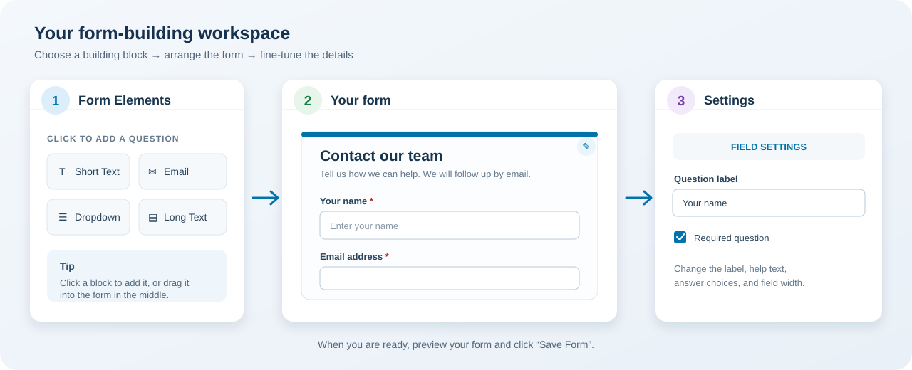

# Form Builder Guide for Beginners

This guide walks you through making a simple online form in CMS Admin. You do
not need to know code.

**Quick-start:** Follow the steps in order, then preview and review before
saving or sharing the form.

## The screen in one minute

| Area | What it does |
| --- | --- |
| **Form Elements** (left) | Choose the kind of question or content to add. |
| **Form canvas** (middle) | See your form take shape. Click a field to select it. |
| **Settings** (right) | Edit the selected field, or choose **Form Settings** for whole-form options. |

## Make your first form

1. Open **Form Builder** from the left-hand menu and choose **+ Create / Builder
   Studio**. The blank canvas is a new form.
2. Click **Templates** if you want a starting point, or keep the blank canvas.
   Picking a template replaces the fields currently on the canvas.
3. Click **Form Settings** on the right. Enter the form title and a short
   description that tells people what the form is for.
4. Click an item under **Form Elements** to add it. You can also drag it onto
   the canvas. Start with just a few questions.
5. Click each new field on the canvas. In **Field Settings**, enter a clear
   label, and adjust the options described below.
6. Click **Preview Form** and try filling the form in. Check it on desktop,
   tablet, and mobile using the screen-size buttons above the canvas.
7. When you are happy with it, click **Save Form**. Wait for the status to say
   **Saved to database** before you leave the page.

## Pick the right building block

| Choose this | When you want to… |
| --- | --- |
| **Short Text** | Ask for a name, subject, or other brief answer. |
| **Email** | Collect an email address. |
| **Phone** | Collect a phone number. |
| **Paragraph (Long Text)** | Let someone write a longer answer. |
| **Number** or **Date Picker** | Collect a number or a date. |
| **Dropdown** | Let someone choose one answer from a compact list. |
| **Radio Group** | Let someone choose one answer from visible options. |
| **Checkboxes** | Let someone choose more than one answer. |
| **Agreement** | Ask for a yes/no agreement. |
| **File Upload** | Let someone attach a document or image. |
| **Address Block** | Collect a mailing or street address. |
| **Star Rating** | Ask for a rating. |
| **Signature** | Provide a signature field. |
| **Section Title**, **Text / Instructions**, or **Divider** | Organize or explain the form. These are for display; they do not collect an answer. |

### Arrange questions

Click a question on the canvas to select it. Its small toolbar lets you:

- Move it up or down.
- Make a copy.
- Open its settings.
- Delete it.

For dropdowns, radio groups, and checkboxes, add and edit the answer choices in
**Field Settings**. Press **Enter** while editing an answer to add another.

## Make questions easy to answer

- Write labels as clear questions or short instructions.
- Add a placeholder only when an example would help.
- Turn on **Required** only when an answer is truly necessary.
- Add help text for details people might otherwise guess about.
- Use **50%** or **33%** width for short items that fit side by side. Use **100%**
  for longer questions. Narrow fields stack on small screens.
- To change a field, choose another option from **Field Element Type**. Check
  the field again afterward; some settings only apply to certain types.

## Form-wide settings

Choose the **Form Settings** tab on the right to edit the title, description,
department, submit-button text, theme color, confirmation message, and alert
email. You can also review the spam-protection and accessibility options.

The selected department can suggest a notification address and color. Verify
the alert email is correct for your team before saving.

## Preview and review

**Preview Form** opens a test preview so you can try the questions, required
fields, and answer choices. Use the desktop, tablet, and mobile buttons above
the canvas to check how the layout changes.

Before sharing a form, ask someone else to review the wording, destination
email, and questions. Also test the form using only a keyboard. The accessibility
option is helpful, but it does not replace checking that the finished form
makes sense to people using assistive technology.

## Save, find, and share

- **Save Form** stores the form in the CMS database. A successful save displays
  **Saved to database**. If saving fails, the builder shows an error; fix it and
  try again.
- After the first save, the browser address includes the form's ID. Bookmark it
  if you want to come back to edit that form. You can also find saved forms on
  the **Forms** page.
- **Share & Embed** shows the form's preview link and embed code. The separate
  public preview link uses the saved form's slug.
- The share dialog also offers a standalone HTML download and a JSON export.
- On the **Forms** page, the trash-can button removes a saved form from the
  directory and stops new submissions. Existing submissions and audit history
  are preserved.

> **Important:** In the current builder, a new form is saved with **Published**
> status. Saving may make it publicly viewable. Review the form before saving,
> and confirm with your CMS administrator before distributing its link. A
> successful save does not by itself confirm that notification emails or a
> production publishing workflow are configured.

## Quick fixes

| What happened? | What to try |
| --- | --- |
| I cannot find my saved form. | Open **Forms** and look for it by title. Make sure you saved successfully. |
| The builder opened a blank form. | Open **Forms** and choose the edit button for the saved form, or use its saved builder link. |
| I cannot save. | Check that the title is not blank and that you have access to the selected workspace. Read the error shown beside the save status. |
| My dropdown has no answers. | Select the field and add answer choices in **Field Settings**. |
| The form looks crowded on a phone. | Switch the canvas to **Mobile** and set long questions to full width. |
| I need to start over. | **Reset Canvas** removes the fields from the current canvas. It does not delete other saved forms. |
