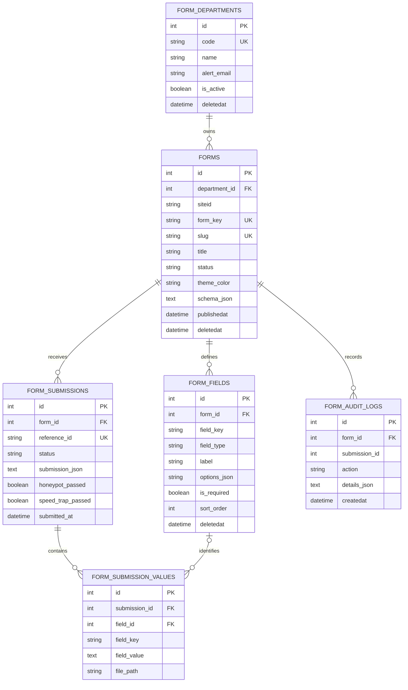

# Chelan County CMS Admin 2.0 — Form Builder Architecture

This document records the Form Builder's schema, application surfaces, and
current behavior for maintainers. For a click-by-click walkthrough, see the
[Form Builder Guide for Beginners](./Form-Builder-Guide.md).

## Overview

The Form Builder is a database-backed visual editor for online forms. Staff
assemble a form from field definitions, save it from the builder, and review
saved forms in the Forms directory. Public submissions are validated against
the saved field definitions and recorded with submission and audit data.

The main editor has three regions:

1. **Form Elements** — field palette.
2. **Canvas** — current form and field ordering.
3. **Settings** — selected-field settings or form-wide settings.


## Current behavior and boundaries

- Saving calls `POST /forms/save`, which inserts or updates the form and
  synchronizes its field rows in a database transaction.
- The successful response returns the saved form, including its database ID,
  form key, and slug. The editor keeps the ID in the browser address so the
  form can be reopened for editing.
- Staff can delete a form from the Forms directory. This sets `forms.deletedat`,
  removes it from active listings and public submission routes, and retains its
  submission and audit records.
- The builder's new-form payload does not currently select a status. The save
  action defaults a missing status to `published`; treat saving a new form as
  publication and review it before distributing its URL.
- The builder preview modal is a client-side test simulation. The standalone
  `/forms/preview` action renders a saved form by slug, key, or ID.
- Submission handling validates saved fields, applies honeypot and elapsed-time
  checks when enabled, stores submission snapshots and normalized values, and
  writes audit events.
- Notifications depend on the application's configured mail transport and
  should be tested separately before the form is distributed.

## Relational schema



### Tables

| Table | Purpose |
| --- | --- |
| `form_departments` | Department code, display name, alert email, badge styling, and active state. |
| `forms` | Form identity, workspace, department, status, messages, notification settings, security thresholds, counters, and cached schema. |
| `form_fields` | Ordered field definitions, display content, options, validation metadata, and soft-delete state. |
| `form_submissions` | One row per accepted submission, including reference, review state, timing, spam checks, request metadata, and JSON snapshot. |
| `form_submission_values` | Searchable field-by-field submission values and uploaded-file metadata. |
| `form_audit_logs` | Form and submission activity such as create/update, received submission, export, and spam block. |

Database setup scripts are provided for SQL Server, MySQL, and PostgreSQL in
`config/sql/schema-form-builder.sql`, `config/sql/schema-mysql.sql`, and
`config/sql/schema-postgresql.sql`. The SQL Server script creates missing
tables and indexes without altering or dropping existing objects. The Wheels
migration is `app/migrator/migrations/20261002220000_create_form_builder_tables.cfc`.

## Form and field data shape

The builder sends JSON shaped like:

```json
{
  "form": {
    "dbId": 17,
    "title": "Contact our team",
    "description": "Tell us how we can help.",
    "department": "PIO",
    "siteid": "global",
    "fields": [
      {
        "id": "f_email",
        "type": "email",
        "label": "Email address",
        "required": true,
        "width": "100"
      }
    ]
  }
}
```

`dbId` is omitted for a new form. The server sanitizes field keys and values,
assigns a unique form key and slug on insert, and uses `field_key` to update
existing field rows without changing their database IDs. Removed fields are
soft-deleted so existing submission values retain their historical meaning.

The field model stores ordinary properties in dedicated columns. Type-specific
options use `options_json`; additional editor properties are carried in
`validation_rules_json`. Content-only field types are `paragraph`, `heading`,
`divider`, `section`, and `html`; they do not collect submission values.

## Application surfaces

| Surface | Responsibility |
| --- | --- |
| `app/controllers/Forms.cfc` | Builder load, database-backed listing, preview, save, submission verification/persistence, department setup, and helper methods. |
| `app/views/forms/builder.cfm` | Three-column builder, templates, preview/share dialogs, and client bootstrap configuration. |
| `app/views/forms/index.cfm` | Database-backed Forms directory, metrics, filters, and links to edit or preview saved forms. |
| `app/views/forms/preview.cfm` | Standalone public-facing form rendering. |
| `javascripts/form-builder.js` | Canvas editing, field inspector, templates, preview simulation, and save request. |
| `stylesheets/form-builder.css` | Builder layout, responsive canvas, controls, and focus styling. |
| `app/models/Form*.cfc` | ORM definitions and associations for form-builder records. |

## Routes

| Method | Path | Action |
| --- | --- | --- |
| `GET` | `/forms` | Forms directory |
| `GET` | `/form-builder` | New builder session |
| `GET` | `/forms/builder?id=<id>` | Edit a saved form (wildcard controller/action route) |
| `GET` | `/forms/preview?slug=<slug>` | Preview a saved form |
| `POST` | `/forms/save` | Create or update a form |
| `POST` | `/forms/delete` | Soft-delete a form and preserve its history |
| `POST` | `/forms/submit` | Validate and record a submission |

The `submissions` and `exportCsv` controller actions provide staff submission
review and CSV export through the application's wildcard routes.

## Security and accessibility

- Builder saves require the signed-in staff workflow and a valid CSRF token.
- Form access and listing are scoped by workspace permissions.
- Public submission checks include honeypot fields and a minimum elapsed delay,
  according to the form's saved settings.
- Uploaded submissions are restricted to configured file extensions and a
  25 MB limit.
- Rendered form fields use explicit labels, required indicators, descriptions,
  and semantic choice groups where applicable.
- A WCAG setting or visual badge is not a substitute for keyboard, screen
  reader, and content review of the completed form.

## Seed data

`config/sql/seeds.sql` seeds department groups only. Starter forms are
intentionally not inserted: staff create forms in the builder.
